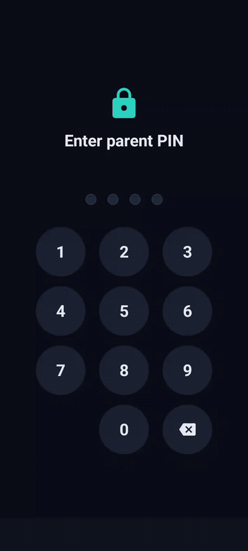

# DetoxWall: App Blocker, Screen Time Limit & Parental Control for Android

**Calm. Simple. Protective.** A free, open-source Android app that blocks apps when their daily time limit runs out, and a **Child Mode** that locks the phone after a daily screen-time allowance. A digital detox and parental control app that works fully offline.

No account, no internet, no ads, no tracking. Everything stays **on the phone**.

<p align="center">
  <a href="https://github.com/IsmailAbdulkareem/Detoxwall/releases/latest/download/DetoxWall.apk">
    
  </a>
</p>

<p align="center">
  
  
  
</p>

---

## Demo

<p align="center">
  
</p>

---

## Download & install

1. **Download:** [DetoxWall.apk](https://github.com/IsmailAbdulkareem/Detoxwall/releases/latest/download/DetoxWall.apk) (latest release).
2. Open the file on your phone. If asked, allow your browser or Files app to **install unknown apps**.
3. Open DetoxWall, create a parent PIN, and grant the permissions it asks for:
   - **Usage access**: measures how long each app is used.
   - **Accessibility**: detects the app on screen and shows the lock. Needed for all blocking.
4. **Android 13+:** if Accessibility is greyed out, go to Settings → Apps → DetoxWall → ⋮ → **Allow restricted settings**, then turn it on again.

---

## How to use it

| Goal | Steps |
|---|---|
| Limit an app | **Apps** tab → add an app → choose a daily limit. When the time is used up, the app is locked. A parent can add 15 minutes with the PIN. |
| Block apps at set times | **Schedules** tab → create a routine (e.g. School hours, Bedtime). Limited apps are blocked while it's active. |
| Focus | **Home** tab → start a focus session. Limited apps are paused until it ends. |
| Protect a child's phone | **Settings** → turn on **Child Mode** and set the daily allowance. The whole phone locks when it's used up. Turning Child Mode off needs the parent PIN. |

---

## Features

| Screen | What it does |
|---|---|
| **Home** | Animated ring with today's real screen time against your goal; focus session timer (15m / 30m / 1h / 2h) with a live countdown; top 5 apps today; a banner when a permission is missing |
| **Apps** | Your limited apps with real icons, time left and colored progress bars; add apps from a searchable picker (most-used first); edit limits with a slider (5 min – 4 h) and presets; pause or remove a limit |
| **Schedules** | Named routines with start/end times, weekday chips and on/off switches; overnight times supported; "Active now" indicator; one-tap starters (School hours, Bedtime, Homework) |
| **Insights** | Bar chart for every day of the month, month-to-month navigation, monthly total and daily average; tap a day to see each app's usage that day |
| **Onboarding** | First run: animated welcome → create a parent PIN (optional) → permissions |
| **PIN screen** | Asks for the parent PIN when the app opens and after 30 s in the background; live countdown during lockout |
| **Settings** | Child Mode switch and daily allowance; Light / Dark / System theme; set or change the parent PIN; "Ask for PIN when opening" switch; permissions |
| **Permissions** | Usage access, accessibility, notifications and battery, each with a live status; tap to open the right system page |
| **Lock screen** | Full-screen lock that Home, Back and Recents can't dismiss. "Close app", parent PIN for 15 more minutes, and an emergency call button when the whole phone is locked |

**Child Mode:** locks the whole phone when the daily screen-time allowance is used or a "lock device" schedule is active. The parent PIN unlocks it for 15 minutes. It also blocks the Settings pages that could disable DetoxWall and its uninstall screen.

**Parent PIN:** 4–8 digits, stored only on the device as a PBKDF2-HMAC-SHA256 hash (120k iterations, random salt, constant-time check). After 5 wrong tries it locks out for 30 s, doubling each time up to 15 min. The lockout survives restarts. Backups are disabled.

**Motion:** tab slides, cards that shrink when pressed, staggered list entry, rolling numbers, growing chart bars, a PIN pad whose dots fill in and shake on a wrong PIN, and a pulsing "active" dot.

---

## How it works

```
UsageStatsManager ──▶ UsageReader ──▶ UsageCalculator (pure) ──▶ ViewModels ──▶ Compose screens
                                                                   ▲
Room DB (limits, schedules, event log) ─▶ DetoxRepository ─────────┤
SettingsStore (prefs → StateFlow) ─────────────────────────────────┤
PinManager (PBKDF2 + lockout) ─────────────────────────────────────┘

Window events ──▶ DetoxAccessibilityService ──▶ Enforcer.decide() (pure) ──▶ LockOverlay (accessibility window)
GuardianService (sticky foreground service) keeps the process alive
```

- **Blocking:** the accessibility service tracks the app on screen and re-checks every 5 s, so an app is locked even if its limit runs out while it's open. The lock is a `TYPE_ACCESSIBILITY_OVERLAY` window, so it needs no "display over other apps" permission.

- **Usage:** today's time per app comes from Android usage *events* (accurate, including the app open right now). Older days fall back to Android's aggregated daily totals when events have expired, which on many phones happens after about a week.
- **Schedules:** overnight windows count the after-midnight part toward the day they **started** (so Monday's 21:30–07:00 is active at 02:00 on Tuesday).
- **DI:** a small manual `AppContainer` created in `DetoxApplication`.

---

## Project structure

```
app/src/main/java/com/example/
├── DetoxApplication.kt / AppContainer.kt   # app entry + manual DI
├── MainActivity.kt                        # 5-tab scaffold, permissions screen
├── data/        # Room entities & DAOs, DetoxRepository, SettingsStore
├── security/    # PinHasher (PBKDF2, lockout policy), PinManager
├── usage/       # UsageCalculator, UsageReader, InstalledApps, Permissions
├── enforcement/ # decision table, accessibility service, lock overlay, foreground service
└── ui/
    ├── theme/       # dark + light color schemes, type, shapes
    ├── components/  # motion helpers, ProgressRing, SectionCard, AppIcon, PinPad
    ├── home/ apps/ schedules/ insights/ settings/ permissions/
specs/v2-strict-rewrite/   # requirements, design, task list
```

---

## Getting started

**Requirements:** Android Studio (recent, with AGP 9 support), and a device or emulator running Android 8.0+ (API 26).

1. **Open** `D:\Video\Desktop\Detoxwall-` in Android Studio and wait for Gradle Sync.
2. **Pick a device.**
   - A phone: turn on Developer options → USB debugging and plug it in.
   - An emulator: Device Manager → create a Pixel on Android 14+.
3. **Run** with ▶ (Shift+F10).
4. **Grant Usage access:** Settings tab → Permissions → Usage access → DetoxWall → allow. Without it, all usage numbers stay at 0.

Command line (use Android Studio's bundled JDK if `java` isn't on your PATH):
```bash
export JAVA_HOME="/c/Program Files/Android/Android Studio/jbr"
./gradlew assembleDebug        # APK at app/build/outputs/apk/debug/app-debug.apk
./gradlew testDebugUnitTest    # unit + Robolectric tests
```

---

## Tests

20 tests, all passing:

| Test | Covers |
|---|---|
| `PinSecurityTest` | PBKDF2 hash and verify, salts, PIN validation, lockout durations |
| `PinManagerTest` | PIN persistence; lockout after 5 tries survives a new instance and expires |
| `UsageCalculatorTest` | sessions, app switches, the app open right now, the app open since before midnight, screen off |
| `ScheduleTest` | daytime and overnight windows, day masks, summaries, time formatting |
| `ExampleRobolectricTest` | resources load |

---

## Roadmap

- [x] First-run onboarding (welcome → create PIN → permissions)
- [x] Parent PIN screen when opening the app (and after 30 s in the background; can be turned off in Settings)
- [x] Blocking when a limit, schedule or focus session is active
- [x] Child Mode with daily allowance and parent-PIN unlock
- [ ] Siren on bypass attempts
- [ ] Screenshot tests for key components

For strong, hard-to-bypass parental control today, Android's built-in **Digital Wellbeing** and Google **Family Link** are the recommended tools. DetoxWall doesn't replace them.

---

## Changes from v1

- Removed the Clerk login and all network code: no `INTERNET` permission.
- The PIN moved from a single SHA-256 hash to PBKDF2 with a lockout.
- Fake seeded usage data removed; all numbers are real.
- Light theme fixed (v1 hardcoded white text).
- The overnight-schedule weekday bug is fixed.
